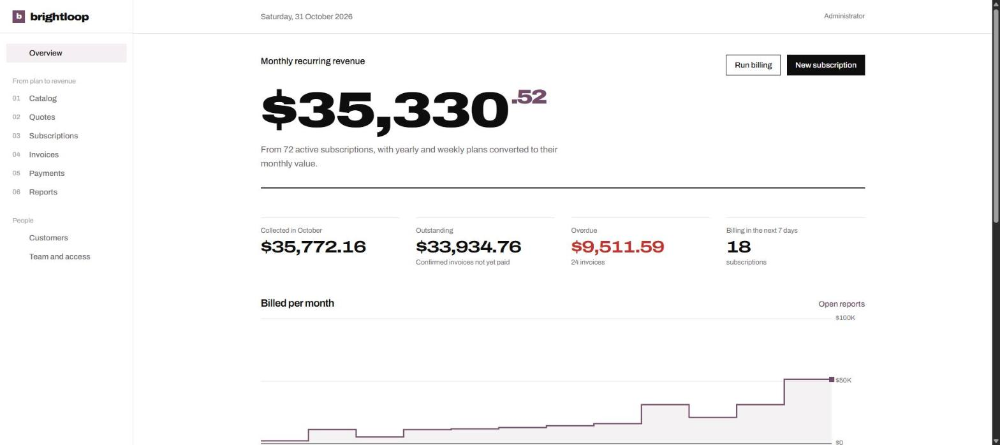
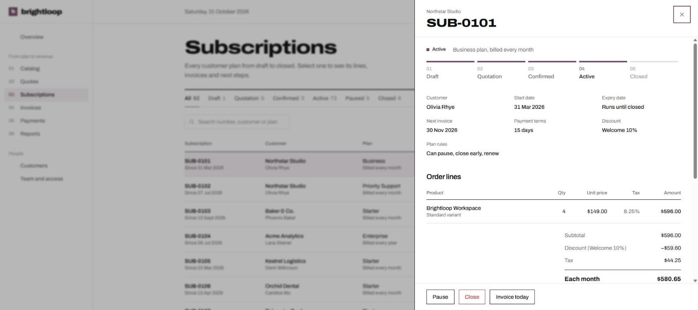
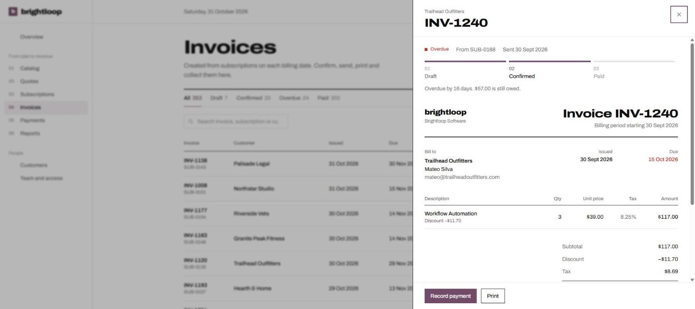
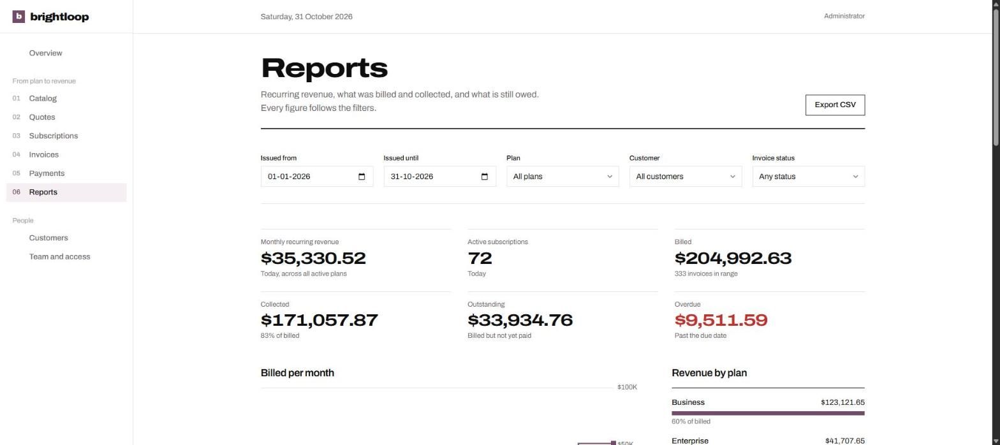
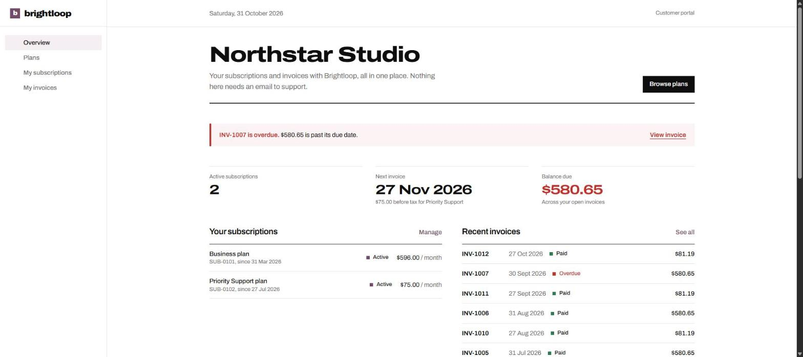
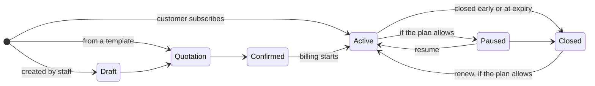
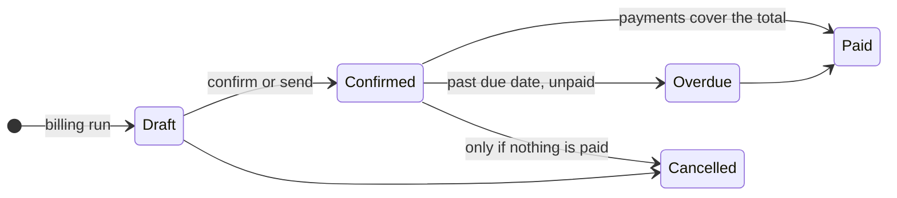
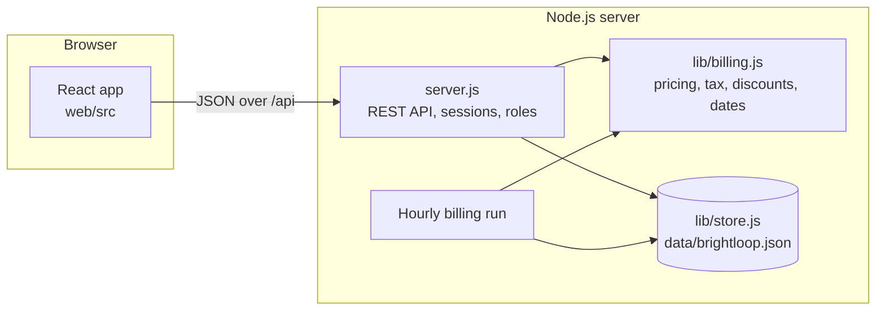

<h1 align="center">brightloop</h1>

<p align="center"><strong>Plans, subscriptions and recurring billing, run in one place.</strong></p>

<p align="center">
  
  
  
  
  
</p>

<p align="center">
  <a href="#run-it-in-a-minute">Run it</a> ·
  <a href="#take-the-three-minute-tour">Three-minute tour</a> ·
  <a href="#every-scene-in-the-brief">Brief coverage</a> ·
  <a href="#how-billing-works">How billing works</a> ·
  <a href="#architecture">Architecture</a> ·
  <a href="#api">API</a> ·
  <a href="#configuration">Configuration</a>
</p>



Brightloop Software earns its money every month but runs on a spreadsheet: renewals get missed, invoices are typed by hand, payments are matched by scrolling bank statements, and nobody can say how much recurring revenue the company has. Brightloop replaces all of that with one system for the admin who sets up the catalog, the team who handle customers day to day, and the customers who want to manage their own subscriptions.

Built for the Odoo hackathon, on the problem statement *Subscription Management System*.

| How it works today | How it works in Brightloop |
| --- | --- |
| Subscriptions live in a spreadsheet | Every subscription has a number, customer, plan, dates, terms and priced lines, and a visible stage from Draft to Closed |
| Renewals are remembered by whoever notices | A billing engine runs every hour, catches up missed periods and closes or keeps plans running according to each plan's rules |
| Invoices are typed up by hand | Invoices are generated from the subscription with customer, lines, tax and discounts already filled in, and never twice for the same period |
| Payments are matched by scrolling bank statements | Payments are recorded against the invoice they pay; paid, outstanding and overdue balances update immediately |
| Revenue reports are built at quarter end | MRR, billed, collected, outstanding and overdue are live, filterable and exportable |

## Run it in a minute

You need Node.js 20.19 or newer. Nothing else: no database server, no external services.

```bash
npm install
npm run build
npm start
```

Open **http://localhost:3000**. The first start creates a demo workspace with a year of history: 36 customers, five plans, about 90 subscriptions in every stage and the 350 or so invoices and payments the billing engine produced for them.

| Sign in as | Email | Password | Sees |
| --- | --- | --- | --- |
| Admin | `admin@brightloop.io` | `Brightloop!2026` | Everything, including the catalog, discounts and team |
| Staff | `staff@brightloop.io` | `Brightloop!2026` | Customers, quotes, subscriptions, billing, payments and reports |
| Customer | `olivia@northstar.io` | `Brightloop!2026` | Only Northstar Studio's subscriptions and invoices |

The sign-in page lists these accounts; click one to fill it in. Delete `data/brightloop.json` and restart to reset the demo.

<details>
<summary>Developing with hot reload</summary>

```bash
npm run dev:api   # API on http://localhost:3000, restarts when server files change
npm run dev       # web app on http://localhost:5173, /api is proxied to the API
npm test          # billing rule tests
```

</details>

## Take the three-minute tour

1. **Sign in as staff.** The overview leads with monthly recurring revenue, then this month's collections, what is outstanding and overdue, a twelve-month billed chart, subscriptions due this week and the overdue chase list.
2. **Quotes → Business plan proposal → Create quotation.** Pick a customer. The price panel shows subtotal, discount, tax and total before anything is saved.
3. In the subscription panel, **Confirm**, then **Activate**, then **Invoice today**. The numbered bar moves from Quotation to Active and the invoice appears underneath.
4. Open the invoice, **Send** it, then **Record payment**. It moves from Draft to Confirmed to Paid and the balance drops to zero.
5. **Reports**: filter by plan or customer, watch every figure follow, then **Export CSV**.
6. **Sign in as admin → Catalog → Discounts → New discount.** Choose it when creating a subscription and it appears on every invoice by itself while it is valid. **Team and access** is where admins add staff.
7. **Sign in as Olivia.** The portal flags her overdue invoice, shows her balance and lets her pause or close a plan only if that plan allows it.

<table>
  <tr>
    <td width="50%"></td>
    <td width="50%"></td>
  </tr>
  <tr>
    <td>Subscription: stage, plan rules, lines with tax, and what the next invoice will be</td>
    <td>Invoice: printable document, payment progress and the actions allowed in its state</td>
  </tr>
  <tr>
    <td width="50%"></td>
    <td width="50%"></td>
  </tr>
  <tr>
    <td>Reports: every figure follows the filters, with revenue by plan and CSV export</td>
    <td>Customer portal: their plans, next invoice, balance and an overdue alert</td>
  </tr>
</table>

## Every scene in the brief

<details open>
<summary><strong>A new customer signs up</strong></summary>

- One account per email, enforced on signup and when staff add customers or team members.
- Passwords need more than eight characters, including an uppercase letter, a lowercase letter and a special character. The form ticks off each rule as you type, and the server checks again.
- **Forgot password** issues a single-use reset link that expires after 30 minutes and is sent to the registered email.
- Three roles: the admin controls everything, staff handle day-to-day work without touching the catalog or team, and customers see only their own records. Only an admin can add a member of staff.
</details>

<details>
<summary><strong>Launching a new plan</strong></summary>

- Products have a name, type, sales price, cost price (margin is shown), notes and variants that change the price. The seeded *Brightloop Workspace* has an Odoo variant that adds 560.
- Plans set the price per unit, billing every day, week, month or year, the minimum quantity and the dates the plan is on sale.
- Per plan, the admin decides whether subscriptions close by themselves at expiry and whether they can be closed early, paused or renewed. The app only offers the actions a plan allows, and the API rejects the rest.
</details>

<details>
<summary><strong>Turning a quote into a subscription</strong></summary>

- Quotation templates hold a plan, product lines and a validity in days. One click starts a prefilled quotation.
- Each subscription has its own number, customer, plan, start date, expiry date and payment terms, and lines with product, variant, quantity, unit price, tax and amount.
- It moves **Draft → Quotation → Confirmed → Active → Closed**, shown as a numbered progress bar that anyone on the team can see. An expired quotation cannot be confirmed.
</details>

<details>
<summary><strong>Billing day</strong></summary>

- Invoices are created from subscriptions by the hourly billing run, the **Run billing** button or **Invoice today**, with customer details, lines, tax and totals filled in.
- Tax comes from the admin's tax rules; switching a rule off stops it applying to new invoices.
- Invoices can be confirmed, sent by email, printed or cancelled, and move **Draft → Confirmed → Paid**.
- Nothing is billed twice or skipped: each subscription and billing period produces exactly one invoice, and a run catches up every missed period one invoice at a time.
</details>

<details>
<summary><strong>A customer asks for a better price</strong></summary>

- Only admins create discounts: a fixed amount or a percentage, with a minimum purchase or quantity, start and end dates and a limit on how many invoices it can apply to.
- A discount covers the whole subscription or specific products.
- Once chosen for a subscription, it appears on the next invoice by itself, is taken off before tax, and stops when it expires or its uses run out. The catalog shows a usage meter and marks discounts as expired or used up.
</details>

<details>
<summary><strong>The money comes in</strong></summary>

- Payments are recorded against an invoice with method, amount, date and a note. Partial payments are supported, and overpaying is refused.
- Invoices show what is paid and what is outstanding; an unpaid confirmed invoice past its due date becomes **Overdue** and shows how many days late it is.
- **Payments** lists every payment with filters by method; the overview keeps a chase list of overdue invoices.
</details>

<details>
<summary><strong>The finance lead, at the end of the month</strong></summary>

- **Overview** answers the month-end questions at a glance: MRR, active subscriptions, collected, outstanding and overdue.
- **Reports** filters by issue date range, plan, customer and invoice status, and shows billed, collected, outstanding and overdue totals, a billed-per-month chart, revenue by plan and the matching invoices as a CSV export.
- Built to stay fast as the books grow: balances are worked out in one pass over payments, records are looked up by id, and long tables render one page at a time. With the demo workspace (about 350 invoices) the main data request answers in about 25 ms.
</details>

## How billing works

The rules live in [`lib/billing.js`](lib/billing.js), a set of pure functions shared by the API, the live price preview and the tests, so what staff see on screen is exactly what customers are billed.

**Pricing an invoice**, using SUB-0101 from the demo data (Business plan, 4 seats, *Welcome 10%* discount, 8.25% sales tax):

| Step | Rule | Amount |
| --- | --- | ---: |
| Subtotal | 4 × $149.00 | $596.00 |
| Discount | 10% of the eligible lines, applied before tax | −$59.60 |
| Tax | 8.25% of the discounted amount ($536.40) | $44.25 |
| **Invoice total** | | **$580.65** |

**Billing dates** keep their anchor day: a subscription that starts on 31 January is billed on 28 February and back on 31 March. Weekly and daily plans step by seven days and one day.

**Subscription lifecycle**



**Invoice lifecycle**



## Architecture



```
server.js              API routes, sessions, role checks, billing scheduler, serves web/dist
lib/billing.js         Pure pricing, tax, discount and billing-calendar rules
lib/store.js           Atomic JSON file store and the demo workspace seed
test/billing.test.js   Checks for passwords, billing dates, tax after discount and discount limits
web/src/
  App.jsx              Routes per role
  lib/                 API client, data hooks, formatting
  components/          Design system: tables, record panels, fields, status marks, lifecycle bar, step chart
  pages/               One screen per file or folder (subscriptions/, invoices/, catalog/, portal/)
```

| Layer | Choice | Why |
| --- | --- | --- |
| Interface | React 19, React Router 7, TanStack Query 5 | Screens refresh after every action without reloading everything |
| Styling | Tailwind CSS 4 with one type scale and a Swiss grid in Odoo plum (`#714B67`) | A consistent, readable interface without a generic component kit |
| Build | Vite 8 | Fast development server and a small production bundle |
| Server | Node.js `http`, no framework | Small, readable routing with no dependencies on the server |
| Storage | Atomic JSON file | Runs anywhere with `npm start`; a transactional database is the next step for multiple instances |
| Tests | `node:test` | Built into Node, nothing to install |

**Security.** Passwords are salted scrypt hashes; sessions are HTTP-only, same-site cookies that expire after 12 hours; sign-in is limited to 10 attempts per 15 minutes; reset tokens are stored hashed and used once. Every data route checks the caller's role, and customers can only read records that belong to their account. Static responses carry a strict Content Security Policy.

## API

All endpoints are under `/api`, take and return JSON, and use the session cookie set at sign-in.

| Method and path | Who | What it does |
| --- | --- | --- |
| `POST /auth/signup` · `POST /auth/login` · `POST /auth/logout` | Anyone | Create a customer account, sign in, sign out |
| `POST /auth/password-reset` · `POST /auth/password-reset/complete` | Anyone | Request a reset link, set a new password |
| `GET /session` · `GET /data` | Signed in | Current user; everything the user's role may see, with balances worked out |
| `GET, POST, PATCH, DELETE /customers`, `/products`, `/plans`, `/taxes`, `/discounts`, `/quote-templates` | Read: signed in. Write: admin (customers: staff too) | Catalog and customer records |
| `POST /users` · `PATCH /users/:id` | Admin | Add staff and change roles |
| `POST /subscriptions` · `POST /subscriptions/preview` | Signed in | Create a subscription or quotation; price lines without saving |
| `GET /subscriptions/:id` · `POST /subscriptions/:id/action` | Owner or staff | Read; move through the lifecycle (quotation, confirm, activate, pause, resume, close, renew) within the plan's rules |
| `PATCH /subscriptions/:id` | Staff | Change lines, discount, payment terms or expiry |
| `POST /billing/run` · `POST /invoices` | Staff | Run billing now; invoice one subscription for a period |
| `GET /invoices/:id` · `POST /invoices/:id/action` | Owner or staff | Read; confirm, send, resend or cancel |
| `POST /invoices/:id/payments` | Staff | Record a payment with method, amount, date and note |
| `GET /reports?from=&to=` | Signed in | Summary figures and invoices for a date range |
| `GET /health` | Anyone | Health check |

## Configuration

| Variable | Default | Purpose |
| --- | --- | --- |
| `PORT` | `3000` | HTTP port |
| `EMAIL_API_URL`, `EMAIL_API_KEY` | not set | HTTP email gateway for password resets and invoices. It receives a JSON POST with `to`, `subject`, `text` and `html`. Without it, development reset links appear on screen and invoice emails wait in a local outbox. |
| `PUBLIC_URL` | `http://localhost:PORT` | Base URL used in emailed links |
| `BUSINESS_TIME_ZONE` | `Asia/Kolkata` | Time zone that decides the billing date |
| `ADMIN_PASSWORD` | not set | Required on the first production start (`NODE_ENV=production`); the demo password is never used in production |
